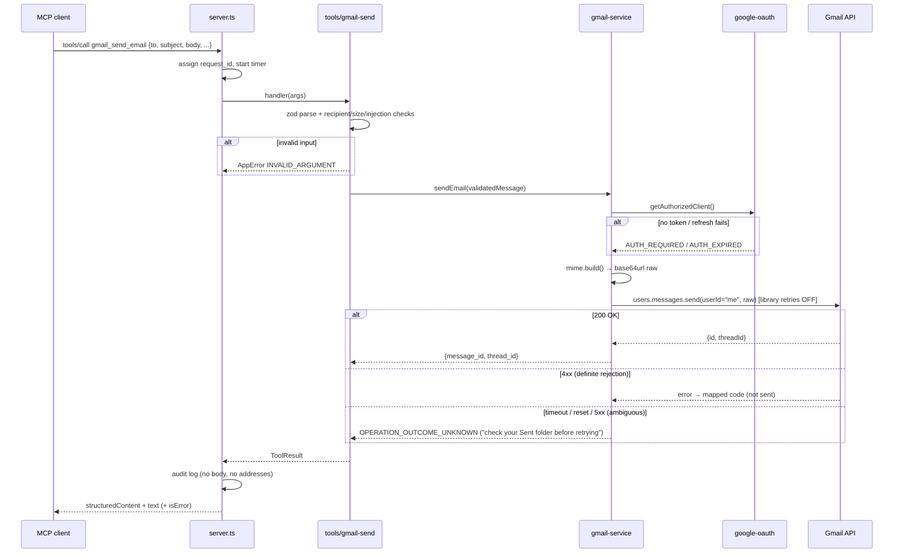
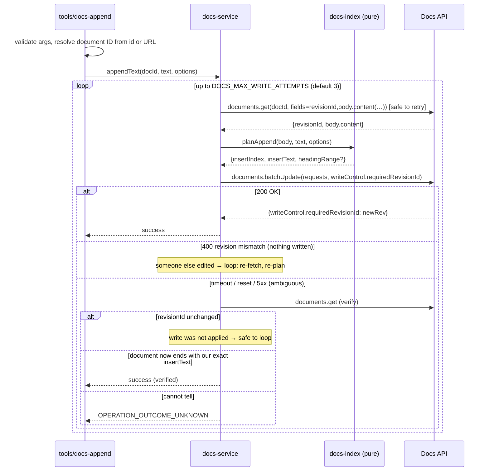

# Architecture: Google Workspace MCP Server (Version 1)

This document describes how the server in [problemStatement.md](problemStatement.md) will be built.
The problem statement is the source of truth for requirements. This document covers the
design decisions, module boundaries, data flows and safety mechanisms used to meet them.
Section references like **FR-3** or **§10** point back to the problem statement.

---

## 1. Scope

Version 1 exposes exactly two MCP tools over a local **stdio** transport:

| Tool | Side effect | Google API |
|---|---|---|
| `gmail_send_email` | Sends a real email from the authenticated account | Gmail `users.messages.send` |
| `google_docs_append_text` | Appends text to the end of an existing Google Doc | Docs `documents.get` + `documents.batchUpdate` |

Not in Version 1 (see §4 of the problem statement): creating docs, reading mail or doc
content, attachments, a web UI, multi-user support, and remote hosting. §16 of this document
outlines how remote hosting could be added later without changing the core modules.

---

## 2. Technology choices

| Concern | Choice | Reason |
|---|---|---|
| Runtime | Node.js 22 LTS or newer, ESM modules (this machine has v26.7.0) | Preferred default in §8 |
| Language | TypeScript, `strict` mode | Typed schemas and error codes |
| MCP | `@modelcontextprotocol/sdk` (official TypeScript SDK), `McpServer` + `StdioServerTransport` | Official SDK required by FR-1 |
| Google APIs | `googleapis` (Gmail v1, Docs v1) and `google-auth-library` (`OAuth2Client`) | Official Google client libraries |
| Validation | `zod` | Used by the MCP SDK to produce JSON Schema for tool inputs and outputs |
| Tests | `vitest` | Fast TypeScript-native test runner with mocking |
| Lint / format | `eslint` + `prettier` | Standard tooling |
| MIME building | Small in-house builder (`src/google/mime.ts`) | The message format is simple (one text or HTML part, no attachments). Writing it ourselves avoids a dependency and lets us unit-test header encoding and injection checks directly |

Dependency versions are the latest stable releases at implementation time and are pinned
through `package-lock.json`. No AI-vendor SDK is a dependency (FR-1, acceptance criterion 13).

---

## 3. System context

```text
 ┌───────────────────────────┐         stdio (JSON-RPC)        ┌─────────────────────────────┐
 │ MCP client                │  ─── initialize / tools/list ──▶│ google-workspace-mcp        │
 │ (Antigravity, Claude,     │  ─── tools/call ───────────────▶│ (Node.js process launched   │
 │  IDE agents, others)      │  ◀── tool result ───────────────│  by the client)             │
 │                           │                                 │                             │
 │ Owns: user confirmation,  │                                 │ Owns: schemas, validation,  │
 │ LLM, approval UI          │                                 │ Google calls, safety rules  │
 └───────────────────────────┘                                 └──────────────┬──────────────┘
                                                                              │ HTTPS + OAuth 2.0
                                                    ┌─────────────────────────┼──────────────────┐
                                                    ▼                         ▼                  ▼
                                             Gmail API v1             Google Docs API v1   Google OAuth
                                                                                           (token refresh)

 One-time setup, run by the person who owns the Google account:
   npm run auth  ──▶ opens browser ──▶ Google consent ──▶ loopback callback ──▶ token file on disk
```

- The client starts the server as a child process and talks to it over stdin/stdout.
- **stdout carries only MCP protocol messages.** All logs go to stderr (§12).
- Clients may launch the process from any working directory, so `.env` and relative paths
  (such as the default token path) are resolved against the project root, found from
  `import.meta.url`, never against `process.cwd()`.
- The server acts as a single Google account: whichever account completed `npm run auth`.
  The README states this clearly (§9 of the problem statement).

---

## 4. Layers and dependency rules

```text
            ┌──────────────────────────────────────────────┐
  Entry     │ index.ts           cli/auth.ts               │  process lifecycle, CLI
            ├──────────────────────────────────────────────┤
  Protocol  │ server.ts  (McpServer, tool registration,    │  only layer that imports the MCP SDK
            │             result formatting)               │
            ├──────────────────────────────────────────────┤
  Tools     │ tools/gmail-send.ts   tools/docs-append.ts   │  zod schemas, argument checks,
            │                                              │  calls one service, builds the result
            ├──────────────────────────────────────────────┤
  Services  │ google/gmail-service.ts                      │  Google API calls, retry policy,
            │ google/docs-service.ts                       │  Google error → AppError mapping
            │ google/mime.ts  google/docs-index.ts (pure)  │
            ├──────────────────────────────────────────────┤
  Auth      │ auth/google-oauth.ts   auth/token-store.ts   │  OAuth client, token load/save/refresh
            ├──────────────────────────────────────────────┤
  Shared    │ config.ts  utils/errors.ts  utils/validation │  used by every layer above
            │ utils/logging.ts  utils/retry.ts             │
            └──────────────────────────────────────────────┘
```

Rules, enforced in code review and checked by an ESLint `no-restricted-imports` rule:

1. Only `server.ts` and `index.ts` import `@modelcontextprotocol/sdk`. Services and tools know
   nothing about MCP, so they can be reused behind a different transport (FR-1, §18).
2. Only `google/*` and `auth/*` import `googleapis` / `google-auth-library`.
3. Tools never call `fetch` or build URLs. There is no generic "call any API" path (§10).
4. Pure logic (`mime.ts`, `docs-index.ts`, `validation.ts`, error mapping) has no I/O, so it
   can be unit-tested without mocks.
5. Services receive their Google clients through a constructor argument. Tests pass fakes;
   production passes real clients built from the OAuth client.

---

## 5. Directory layout

```text
mcp_server/
├── src/
│   ├── index.ts                 # Entry: load config, build deps, start stdio server, signal handling
│   ├── server.ts                # createServer(deps): registers both tools, wraps handlers
│   ├── config.ts                # Reads + validates env vars with zod; never prints secret values
│   ├── cli/
│   │   └── auth.ts              # `npm run auth` and `npm run auth -- --status` / `--revoke`
│   ├── auth/
│   │   ├── google-oauth.ts      # Builds OAuth2Client, loopback + PKCE consent flow, refresh handling
│   │   └── token-store.ts       # Atomic read/write of the token file with restricted permissions
│   ├── google/
│   │   ├── clients.ts           # Builds Gmail/Docs API clients from the OAuth client (keeps index.ts free of googleapis)
│   │   ├── gmail-service.ts     # sendEmail(): builds MIME, calls users.messages.send once
│   │   ├── mime.ts              # Pure RFC 5322 / MIME builder + base64url encoding
│   │   ├── docs-service.ts      # appendText(): get → plan → batchUpdate with revision guard
│   │   ├── docs-index.ts        # Pure: end-index and separator calculation from a document
│   │   └── google-errors.ts     # Maps Google/gaxios errors to AppError codes
│   ├── tools/
│   │   ├── gmail-send.ts        # Tool name, description, annotations, input/output schemas, handler
│   │   └── docs-append.ts       # Same for the Docs tool, incl. document ID/URL parsing
│   └── utils/
│       ├── errors.ts            # AppError class + ErrorCode union
│       ├── validation.ts        # Email address, doc ID/URL, header-injection checks
│       ├── logging.ts           # JSON-lines logger to stderr with redaction
│       └── retry.ts             # Bounded exponential backoff with full jitter
├── tests/
│   ├── unit/                    # No network. Runs in CI and on every `npm test`
│   ├── integration/             # Real Google calls. Opt-in only (see §14)
│   └── fixtures/                # Sample Docs API responses (empty doc, tables, trailing blanks…)
├── .env.example
├── .gitignore                   # .env, .local/, *.token.json, credentials*.json, dist/, coverage/
├── package.json
├── tsconfig.json
├── eslint.config.js
├── vitest.config.ts
├── README.md
├── architecture.md
└── problemStatement.md
```

Build output goes to `dist/`. The MCP client runs `node dist/index.js`.

---

## 6. Tool contracts

Both tools are registered with `server.registerTool(name, { title, description, inputSchema,
outputSchema, annotations }, handler)`.

### 6.1 Shared result envelope (FR-5)

Every call returns **both** `structuredContent` (machine-readable) and one `text` content item
(a short human-readable sentence followed by the same JSON), so clients that ignore structured
content still get the data.

```ts
type ToolResult =
  | { success: true; message: string; /* tool-specific fields */ }
  | { success: false; error: { code: ErrorCode; message: string; retryable: boolean } };
```

- Failures set MCP `isError: true`.
- `retryable` tells the agent whether trying again is safe. It is always `false` for
  `OPERATION_OUTCOME_UNKNOWN`.
- `ErrorCode` is exactly the list in FR-5: `INVALID_ARGUMENT`, `AUTH_REQUIRED`, `AUTH_EXPIRED`,
  `PERMISSION_DENIED`, `RESOURCE_NOT_FOUND`, `QUOTA_EXCEEDED`, `RATE_LIMITED`,
  `GOOGLE_API_ERROR`, `NETWORK_ERROR`, `OPERATION_OUTCOME_UNKNOWN`, `INTERNAL_ERROR`.

### 6.2 MCP tool annotations

Annotations are hints that let clients decide when to ask the user for confirmation (§10,
"Explicit intent"). The server does not depend on clients honouring them.

| Annotation | `gmail_send_email` | `google_docs_append_text` |
|---|---|---|
| `readOnlyHint` | `false` | `false` |
| `destructiveHint` | `false` (adds, does not delete) | `false` (append only) |
| `idempotentHint` | `false` (each call sends a new email) | `false` (each call appends again) |
| `openWorldHint` | `true` | `true` |

### 6.3 `gmail_send_email`

**Description (shown to agents):**
> Sends a real email immediately from the user's authenticated Gmail account. This cannot be
> undone. Confirm the recipients, subject and body with the user before calling unless they
> have explicitly asked you to send it. Use only to send a new message; this tool cannot read,
> search, reply in-thread or attach files.

**Input schema:**

| Field | Type | Required | Rules |
|---|---|---|---|
| `to` | `string \| string[]` | yes | 1+ valid addresses |
| `subject` | `string` | yes | Not blank after trim; max `GMAIL_MAX_SUBJECT_CHARS` (default 500); no CR/LF |
| `body` | `string` | yes | Not blank after trim; max `GMAIL_MAX_BODY_BYTES` UTF-8 bytes (default 1 MB) |
| `cc` | `string \| string[]` | no | Valid addresses |
| `bcc` | `string \| string[]` | no | Valid addresses |
| `body_type` | `"text" \| "html"` | no | Default `"text"` |
| `reply_to` | `string` | no | One valid address |

Additional checks:
- Total of `to` + `cc` + `bcc` ≤ `GMAIL_MAX_RECIPIENTS` (default 50). Duplicates across fields
  are rejected rather than silently removed, so the server never changes who receives the mail.
- Addresses must be bare `local@domain` (no display names in V1). Validation uses a pragmatic
  pattern (no spaces, one `@`, a dotted domain, max 254 chars) and rejects `\r`, `\n`, `,`, `;`
  and `<>` to block header injection.
- No field accepts URLs, tokens or headers (FR-2).

**Success output:** `{ success: true, message: "Email sent.", message_id, thread_id }`.
The response never echoes the body or recipient list.

### 6.4 `google_docs_append_text`

**Description (shown to agents):**
> Appends text to the end of an existing Google Doc owned by or shared with the authenticated
> user. Existing content is never changed or removed. This modifies the document immediately.
> Provide either `document_id` or `document_url`. The tool will not create a document. Text is
> inserted as plain text; Markdown is not converted to formatting.

**Input schema:**

| Field | Type | Required | Rules |
|---|---|---|---|
| `document_id` | `string` | one of these two | Matches `^[A-Za-z0-9_-]{25,128}$` |
| `document_url` | `string` | one of these two | See URL rules below |
| `text` | `string` | yes | Not blank after trim; max `DOCS_MAX_APPEND_CHARS` (default 50,000) |
| `add_separator_newline` | `boolean` | no | Default `true` (see §8.3) |
| `heading` | `string` | no | Max 200 chars, no newlines. Inserted as its own `HEADING_2` paragraph before `text` |
| `insert_timestamp` | `boolean` | no | Default `false`. Adds a line `YYYY-MM-DD HH:mm <TZ>` before the text, in `DOCS_TIMESTAMP_TIMEZONE` (default `UTC`) |

Exactly one of `document_id` / `document_url` must be given. The JSON Schema marks both as
optional (the SDK takes a flat object shape) and the handler enforces "exactly one" with a
clear `INVALID_ARGUMENT` message.

**URL rules** (`utils/validation.ts`), parsed with the WHATWG `URL` class, never with a regex
on the raw string:
- Scheme must be `https:`.
- Host must be exactly `docs.google.com`. No other subdomains, no lookalike hosts, no
  credentials in the URL, no non-default port.
- Path must match `/document/d/{id}/…` or `/document/u/{n}/d/{id}/…`. Paths for Sheets, Slides,
  Forms or Drive (`/spreadsheets/`, `/presentation/`, `/forms/`, `drive.google.com`) are
  rejected with a message that says only Google Docs are supported.
- The extracted `{id}` must pass the same ID rule as `document_id`.

**Success output:**
`{ success: true, message: "Text appended.", document_id, document_url, appended_characters }`.
The document's content is never returned (FR-3).

---

## 7. Flow: sending an email



### 7.1 MIME construction (`google/mime.ts`)

Produces a single-part message:

```text
To: a@example.com, b@example.com
Cc: c@example.com
Bcc: d@example.com
Reply-To: e@example.com
Subject: =?UTF-8?B?...?=            ← RFC 2047 encoded-word only when non-ASCII
MIME-Version: 1.0
Content-Type: text/plain; charset="UTF-8"     (or text/html)
Content-Transfer-Encoding: base64

<body, base64, wrapped at 76 chars>
```

- `From` is left out; Gmail fills it with the authenticated address.
- `Bcc` is included in the raw message; Gmail delivers to those addresses and removes the
  header before sending. A unit test asserts the header is only present when `bcc` is given.
- `Date` and `Message-ID` are added by Gmail.
- Line endings are CRLF. The whole message is base64url-encoded (no padding) for the `raw` field.
- The body is base64 transfer-encoded, so its content is never interpreted as headers.

### 7.2 Why there is no automatic retry on send

Gmail has no idempotency key for `messages.send`. If a request times out or the connection
drops after the request was sent, Gmail may already have accepted it. So:

| Failure | Sent? | Code returned | Auto-retry |
|---|---|---|---|
| Validation error, missing auth | No (no request made) | `INVALID_ARGUMENT` / `AUTH_*` | n/a |
| DNS failure, connection refused (request never left) | No | `NETWORK_ERROR`, `retryable: true` | No. The agent may retry |
| HTTP 400 / 401 / 403 / 404 | No | Mapped code (§10) | No |
| HTTP 429, 403 `rateLimitExceeded` | No | `RATE_LIMITED`, `retryable: true` | No. The agent decides |
| Timeout, socket reset, HTTP 5xx | Unknown | `OPERATION_OUTCOME_UNKNOWN`, `retryable: false` | Never |

The `googleapis` request option `retry: false` is set explicitly on this call so the library
cannot retry behind our back.

---

## 8. Flow: appending to a Google Doc



### 8.1 Concurrency and duplicate prevention

The key mechanism is **`writeControl.requiredRevisionId`** on `batchUpdate`. Google applies
the update only if the document is still at the revision we read; otherwise it rejects the
whole request with HTTP 400 and writes nothing. This gives us:

- **No overwrite from stale indexes.** The insertion index is always computed from the exact
  revision being written to.
- **Safe retries.** A revision-mismatch rejection means nothing was written, so re-fetching and
  retrying cannot duplicate text.
- **Ambiguous failures can be checked.** If the revision is unchanged after a timeout, the
  write did not happen. If it changed, we check whether the document's tail is exactly our
  inserted text. If neither is conclusive (for example, another user also edited), we return
  `OPERATION_OUTCOME_UNKNOWN` rather than risk a second insert (§11).

All requests for one call (text insert, optional heading style) go in **one** `batchUpdate`,
which Google applies atomically.

### 8.2 End-index calculation (`google/docs-index.ts`)

Facts about the Docs API this relies on:
- `body.content` is a list of structural elements, each with `startIndex` / `endIndex`
  (UTF-16 code units). The first element is a section break ending at index 1.
- The body always ends with a paragraph whose last character is a newline that cannot be
  deleted or written after.
- The last element of the body is always a paragraph, even when a table is the last visible
  thing.

Algorithm:

```text
last          = body.content[-1]                     // must be a paragraph, else GOOGLE_API_ERROR
insertIndex   = last.endIndex - 1                    // just before the final, protected newline
tailParas     = trailing paragraphs of body.content, read backwards
trailingEmpty = number of trailing paragraphs whose text is exactly "\n"
docIsEmpty    = body has only the section break + one empty paragraph
```

`insertIndex` is never assumed to be `1` and never equals `last.endIndex` (which the API
rejects). For an empty document it naturally resolves to `1`.

### 8.3 Separator rules

Goal: new content always starts on its own paragraph and, when `add_separator_newline=true`,
sits one blank line below existing content, without adding extra blank lines when the
document already ends with some.

| Document ends with | `add_separator_newline=true` prefix | `false` prefix |
|---|---|---|
| Empty document | `""` | `""` |
| Non-empty paragraph (`…text\n`) | `"\n\n"` → one blank line | `"\n"` → new paragraph |
| One empty paragraph (`…text\n\n`) | `"\n"` | `""` |
| Two or more empty paragraphs | `""` | `""` |

Final inserted string: `prefix + [timestamp + "\n"] + [heading + "\n"] + text`.
If `heading` is set, an `updateParagraphStyle` request with `namedStyleType: HEADING_2` covers
exactly the heading's range, computed from `insertIndex` and the prefix/timestamp lengths in
UTF-16 units. Text after it keeps `NORMAL_TEXT`.

`text` is inserted as given. Line breaks in `text` become paragraphs. Markdown symbols stay
literal.

**Style inheritance.** New paragraphs created by `insertText` copy the style of the paragraph
they split from. If a document ends with a bullet item or a heading, the appended text would
otherwise become bullets or a heading too. So the same `batchUpdate` also contains, for the new
range only:
- `deleteParagraphBullets`,
- `updateParagraphStyle` with `namedStyleType: NORMAL_TEXT` (then `HEADING_2` for the heading line),
- `updateTextStyle` with `fields: "*"` and an empty style, which clears inherited bold, links etc.

The new range starts at `insertIndex + 1` when the prefix is not empty, because the first
inserted `"\n"` closes the existing last paragraph and must not restyle it. When the prefix
is empty, it starts at `insertIndex`, which is inside an empty paragraph. Requests run in
order, so all style ranges use indexes as they are after the insert.

### 8.4 Limits of V1 for Docs

- Documents with multiple **tabs**: text is appended to the first tab (the default `body`
  returned without `includeTabsContent`). This is documented in the README.
- If the account has only comment or view access, Google returns 403 → `PERMISSION_DENIED`.
- A Sheets/Slides/Drive file ID passed as `document_id` gets a 400/404 from the Docs API →
  `RESOURCE_NOT_FOUND` with a hint that only Google Docs are supported.

---

## 9. Authentication and token lifecycle

### 9.1 OAuth model

- **Client type:** Google OAuth client of type **Desktop app** (installed application).
- **Flow:** Authorization Code with **PKCE** and a **loopback redirect**
  (`http://127.0.0.1:<port>/oauth2callback`). This is Google's supported flow for local tools.
  The out-of-band copy-paste flow is deprecated and not used.
- **Scopes requested** (§8 of the problem statement):
  - `https://www.googleapis.com/auth/gmail.send`
  - `https://www.googleapis.com/auth/documents`
  - Proposed, pending approval: `openid` and `email`, which are non-sensitive and let
    `npm run auth -- --status` show which Google account the server acts as. See §15.
- No Gmail read/modify scopes. The README explains that `documents` grants read/write on every
  doc the account can access, which is broader than append-only.

### 9.2 Consent happens outside the MCP session

The consent flow runs in a separate command, **`npm run auth`** (`src/cli/auth.ts`), not
inside a tool call:

1. Start a temporary HTTP listener on `127.0.0.1` only.
2. Open the browser to Google's consent page (also print the URL to stderr as a fallback).
3. Receive the code on the loopback callback, check `state`, exchange it with the PKCE verifier.
4. Save tokens via `token-store.ts`, then close the listener.

Reasons: stdout belongs to the MCP protocol in stdio mode, many clients run the server
headless, and a model must never be the party completing consent. Users are never asked to
paste tokens into a prompt or tool argument (§9).

Other commands: `npm run auth -- --status` (prints account, granted scopes and expiry; never
the tokens) and `npm run auth -- --revoke` (revokes at Google and deletes the file).

### 9.3 Token storage

- Path: `GOOGLE_TOKEN_PATH`, default `./.local/google-token.json` (gitignored). The README
  recommends a path in the user profile, outside the repo.
- Written atomically (write to temp file, then rename). On macOS/Linux the file is created
  with mode `0600` and its directory with `0700`. On Windows the file lives under the user's
  profile and inherits user-only ACLs; the README notes this.
- Contents: refresh token, access token, expiry, granted scopes. Nothing else.

### 9.4 Runtime behaviour

| Situation | Behaviour |
|---|---|
| Client ID/secret missing or malformed | Server **refuses to start**, prints which variable is wrong (never the value) to stderr |
| Token file missing | Server **starts** so tools are still discoverable. Tool calls return `AUTH_REQUIRED`: "Run `npm run auth`" |
| Access token expired | `OAuth2Client` refreshes automatically. A `tokens` event handler saves any new tokens |
| Refresh returns `invalid_grant` (revoked, expired, password change, 7-day limit for apps in "Testing" mode) | `AUTH_EXPIRED`: "Run `npm run auth` again" |
| Granted scopes missing a needed scope | `AUTH_REQUIRED` naming the missing capability (not the raw scope error) |

The token file is re-read when it changes, so re-authorising does not require restarting the
MCP client.

---

## 10. Error model and mapping

`utils/errors.ts` defines `AppError { code, message, retryable, cause? }`. `cause` is kept for
debug logging only and is **never** sent to the client.

`google/google-errors.ts` maps library errors:

| Source signal | Code |
|---|---|
| zod failure, our own checks, Google 400 `invalidArgument` / bad header | `INVALID_ARGUMENT` |
| No token file | `AUTH_REQUIRED` |
| 403 `insufficientPermissions` / missing scope | `AUTH_REQUIRED` |
| 401, refresh `invalid_grant` | `AUTH_EXPIRED` |
| 403 `forbidden`, no edit access | `PERMISSION_DENIED` |
| 404, Docs 400 "not a document" | `RESOURCE_NOT_FOUND` |
| 403 `dailyLimitExceeded` / `quotaExceeded` | `QUOTA_EXCEEDED` |
| 429, 403 `rateLimitExceeded` / `userRateLimitExceeded` | `RATE_LIMITED` |
| Other 4xx/5xx on a read, or on a write where nothing was applied | `GOOGLE_API_ERROR` |
| `ENOTFOUND`, `ECONNREFUSED`, `EAI_AGAIN` (request never delivered) | `NETWORK_ERROR` |
| Timeout / reset / 5xx on a write that could not be verified | `OPERATION_OUTCOME_UNKNOWN` |
| Anything unexpected (bugs) | `INTERNAL_ERROR` |

Client-facing messages are fixed strings written by us, for example
"The authenticated Google account cannot edit this document. Ask the owner for edit access."
Raw Google response bodies are never passed through (§10, "Safe errors").

**Crash isolation:** `server.ts` wraps every handler in `try/catch`. Any thrown error becomes a
`ToolResult` with `isError: true`. `index.ts` also handles `unhandledRejection` by logging it.
One failing call cannot stop the server (§11).

---

## 11. Retries, timeouts and rate limits

`utils/retry.ts` provides `withRetry(fn, { maxAttempts, baseMs, maxMs, isRetryable })` using
exponential backoff with full jitter, and honours a `Retry-After` header when present.

| Operation | Retried automatically? | Policy |
|---|---|---|
| `documents.get` | Yes | Up to 3 attempts on 429/5xx/network errors, base 500 ms, cap 8 s |
| `documents.batchUpdate` | Only via the revision-guarded loop in §8.1 | Max `DOCS_MAX_WRITE_ATTEMPTS` (3) |
| `users.messages.send` | **Never** | See §7.2 |
| Token refresh | Handled by `google-auth-library` | Failure → `AUTH_EXPIRED` |

Every Google request has a timeout (`GOOGLE_API_TIMEOUT_MS`, default 20 s). Library-level
retries (`retry: false`) are turned off on all calls so the policy in this table is the only
one in effect.

---

## 12. Logging, audit and privacy

- **Output:** JSON lines to **stderr**. Level from `LOG_LEVEL` (`error|warn|info|debug`,
  default `info`).
- **Audit record per tool call (info level):**
  `{ ts, level, request_id, tool, outcome, error_code?, duration_ms, attempt_count }` plus
  non-identifying counts such as `recipient_count` and `text_length`.
- **Never logged at any level:** email bodies, subjects, recipient addresses, document text,
  headings, document contents, tokens, client secret, `Authorization` headers.
  Document IDs are logged only as a short hash so calls can be correlated without exposing them.
- **Redaction safety net:** the logger drops keys whose name contains `token`, `secret`,
  `authorization` or `password`, drops keys named exactly `raw`, `body`, `text`, `heading`,
  `subject`, `to`, `cc`, `bcc` or `reply_to`, and masks strings
  that look like Google tokens (`ya29.…`, `1//…`). A unit test feeds it a realistic error
  object and asserts nothing sensitive comes out.
- `request_id` is a random UUID per call. It is returned in the text content so a user can
  quote it when reporting a problem.

**Untrusted content (§10, prompt injection):** tool arguments and document content are
treated as data. The server never parses them for instructions, never widens scopes and
never calls anything except the two fixed API operations per tool.

---

## 13. Configuration

`config.ts` reads the environment once at startup, validates it with zod and exposes a frozen
`Config` object. `.env` is loaded only if present (via Node's built-in `--env-file-if-exists`
or `process.loadEnvFile`, so no `dotenv` dependency is needed).

| Variable | Required | Default | Purpose |
|---|---|---|---|
| `GOOGLE_OAUTH_CLIENT_ID` | yes | – | Desktop OAuth client ID |
| `GOOGLE_OAUTH_CLIENT_SECRET` | yes | – | Desktop OAuth client secret (keep out of git) |
| `GOOGLE_OAUTH_REDIRECT_PORT` | no | `53682` | Loopback port used by `npm run auth` |
| `GOOGLE_TOKEN_PATH` | no | `./.local/google-token.json` | Token file location |
| `GOOGLE_API_TIMEOUT_MS` | no | `20000` | Per-request timeout |
| `GMAIL_MAX_RECIPIENTS` | no | `50` | To + Cc + Bcc limit |
| `GMAIL_MAX_SUBJECT_CHARS` | no | `500` | Subject length limit |
| `GMAIL_MAX_BODY_BYTES` | no | `1048576` | Body size limit (UTF-8 bytes) |
| `DOCS_MAX_APPEND_CHARS` | no | `50000` | Max characters appended per call |
| `DOCS_MAX_WRITE_ATTEMPTS` | no | `3` | Revision-guarded write attempts |
| `DOCS_TIMESTAMP_TIMEZONE` | no | `UTC` | IANA zone used when `insert_timestamp=true` |
| `LOG_LEVEL` | no | `info` | Log verbosity |

The problem statement's example `GOOGLE_OAUTH_REDIRECT_URI` is replaced by
`GOOGLE_OAUTH_REDIRECT_PORT`, because Desktop clients accept any loopback port and the host
is fixed to `127.0.0.1`. This difference is documented in the README (§12 allows it).

Example MCP client configuration (the exact file and key names vary per client):

```json
{
  "mcpServers": {
    "google-workspace": {
      "command": "node",
      "args": ["C:/NextLeap/mcp_server/dist/index.js"],
      "env": { "GOOGLE_TOKEN_PATH": "C:/Users/<you>/.config/google-workspace-mcp/token.json" }
    }
  }
}
```

---

## 14. Testing strategy

### 14.1 Unit tests (`tests/unit`, always run, no network)

| Area | What is tested |
|---|---|
| `validation.ts` | Valid/invalid addresses, injection characters, doc ID pattern, every URL rule incl. lookalike hosts (`docs.google.com.evil.com`, `docs-google.com`), `http:`, Sheets/Slides paths, `/u/1/` URLs |
| `mime.ts` | Header set per input, CRLF endings, RFC 2047 subject, base64 body, base64url raw, Bcc only when given, `text` default, HTML content type |
| `docs-index.ts` | Fixtures: empty doc, single line, trailing 1 and 2+ blank paragraphs, doc ending in a table, emoji/surrogate pairs (UTF-16 index maths), heading range |
| `docs-service.ts` | Fake Docs client: revision mismatch → re-fetch and success; timeout + unchanged revision → retry; timeout + matching tail → verified success; timeout + unrelated change → `OPERATION_OUTCOME_UNKNOWN`; insert called at most once per revision |
| `gmail-service.ts` | Fake Gmail client: success; 4xx mapping; timeout → `OPERATION_OUTCOME_UNKNOWN` and **send called exactly once** |
| `google-errors.ts` | Every row of §10 |
| `logging.ts` | Redaction of tokens, bodies and recipients |
| `server.ts` | In-memory MCP client (SDK `InMemoryTransport`): `tools/list` returns exactly two tools with correct names, descriptions, required fields, enums and annotations; a thrown handler error does not break the next call |
| `config.ts` | Missing/invalid variables fail with a message that names the variable but not its value |

### 14.2 Integration tests (`tests/integration`, opt-in)

Skipped unless **all** of these are set:
- `RUN_INTEGRATION_TESTS=1`
- `INTEGRATION_TEST_RECIPIENT` — must also appear in `INTEGRATION_RECIPIENT_ALLOWLIST`
- `INTEGRATION_TEST_DOC_ID` — a dedicated test document

Tests: authenticate; send an email with a unique marker to the allowlisted test mailbox;
append a unique marker to the test doc and verify it is at the end and that the earlier
content (snapshot taken before the append) is unchanged; invalid doc ID →
`RESOURCE_NOT_FOUND`; a doc the test account cannot edit → `PERMISSION_DENIED`. Revoked-token
and rate-limit cases are covered with mocks.

### 14.3 Manual check in an MCP client

Connect from Antigravity (and any other client being claimed), confirm both tools appear,
confirm the client asks before calling them, and run one send and one append end to end.
The README lists only clients that have actually been tested (acceptance criterion 14).

---

## 15. Decisions that need approval

| # | Decision | Recommendation |
|---|---|---|
| 1 | Add `openid` + `email` scopes so the server can show which account it uses | Yes. They are non-sensitive and help avoid acting as the wrong account |
| 2 | Bare email addresses only, no display names (`"Ann <ann@x.com>"`) in V1 | Yes. Simpler validation, smaller injection surface |
| 3 | Duplicate recipients across to/cc/bcc are rejected, not merged | Yes. The server never changes the recipient list |
| 4 | `add_separator_newline=false` still starts a new paragraph instead of joining the last line | Yes. Joining text onto someone else's sentence is rarely wanted |
| 5 | Include `heading` and `insert_timestamp` in V1 | Yes. Both are small and fit the single atomic `batchUpdate` |
| 6 | Multi-tab documents: append to the first tab only | Yes for V1; a `tab_id` field could come later |
| 7 | Use `GOOGLE_OAUTH_REDIRECT_PORT` instead of `GOOGLE_OAUTH_REDIRECT_URI` | Yes |

---

## 16. Future: remote hosting (not in V1)

Because the MCP SDK is only used in `server.ts`/`index.ts`, remote hosting is an additive
change:

- New entry point using the SDK's **Streamable HTTP** transport behind HTTPS.
- MCP client authentication per the MCP authorization spec (OAuth 2.1), plus `Origin` checks.
- **Per-user** Google OAuth with a server-side callback (Web OAuth client) and a token store
  keyed by authenticated user (encrypted at rest, e.g. a cloud secret manager or database).
  `token-store.ts` becomes an interface with file and database implementations.
- Services take the per-request user's OAuth client instead of a single shared one, so there
  is no way to fall back to a developer's personal account (§9).
- Google OAuth app verification will likely be needed for users outside the test-user list.

None of the tool, service, validation or MIME code changes for this.

---

## 17. Requirement traceability

| Requirement | Where it is handled |
|---|---|
| FR-1 MCP protocol, separation | §2, §4 rules 1–2, `server.ts`, `index.ts` |
| FR-2 Gmail tool | §6.3, §7, `tools/gmail-send.ts`, `gmail-service.ts`, `mime.ts` |
| FR-3 Docs append tool | §6.4, §8, `tools/docs-append.ts`, `docs-service.ts`, `docs-index.ts` |
| FR-4 Descriptions and schemas | §6.2–6.4, schema unit tests |
| FR-5 Consistent responses | §6.1, §10 |
| §9 Auth and tokens | §9 |
| §10 Security and privacy | §6 validation, §7.2, §8.1, §10, §12 |
| §11 Reliability | §7.2, §8.1, §11 |
| §12 Configuration | §13 |
| §13 Testing | §14 |
